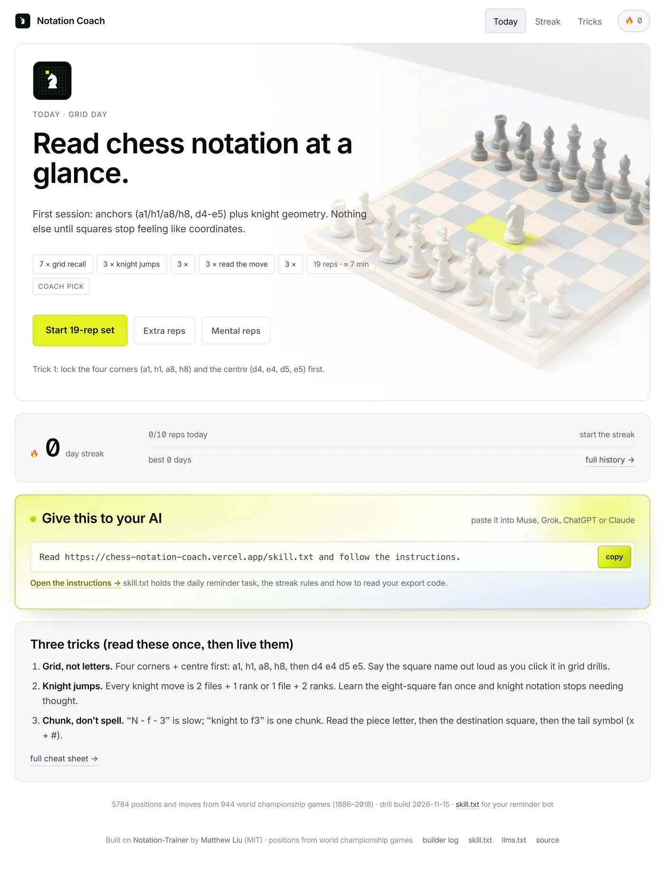
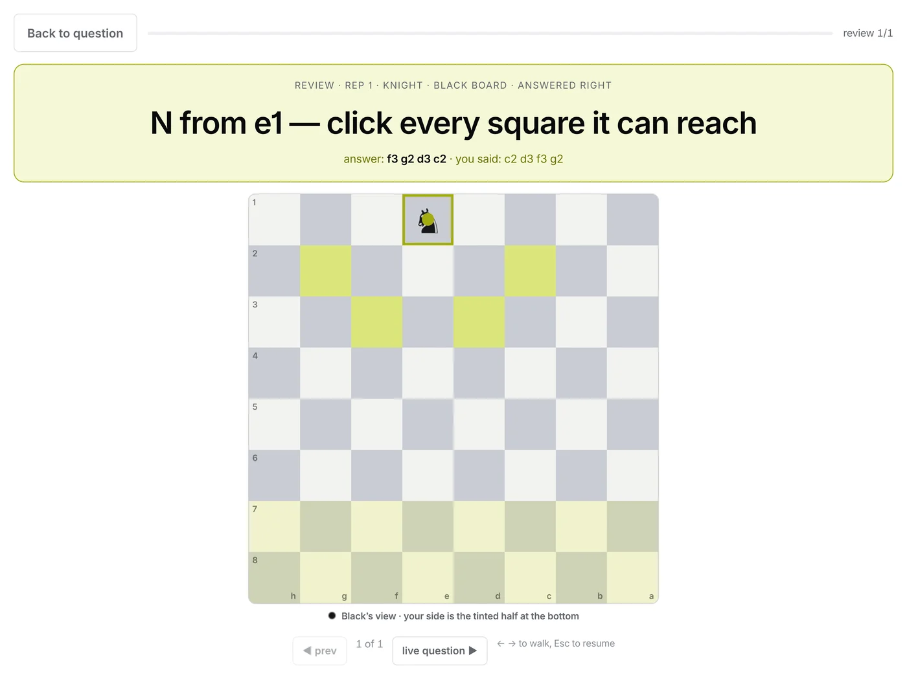
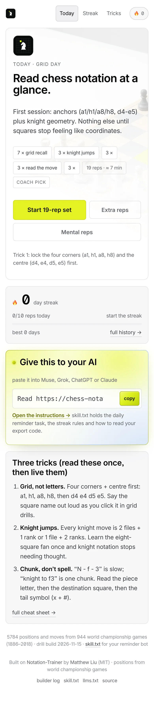

<p align="center">
  
</p>

<h1 align="center">Notation Coach</h1>

<p align="center"><strong>Read chess notation at a glance — one five-minute set a day.</strong></p>

<p align="center">
  <a href="https://chess-notation-coach.vercel.app/"></a>
  
  
  
</p>

<p align="center">
  <a href="https://chess-notation-coach.vercel.app/">Live app</a> ·
  <a href="https://chess-notation-coach.vercel.app/#/tricks">The three tricks</a> ·
  <a href="https://chess-notation-coach.vercel.app/skill.txt">skill.txt</a> ·
  <a href="https://chess-notation-coach.vercel.app/builder-log.txt">build log</a>
</p>

<p align="center">
  <a href="https://chess-notation-coach.vercel.app/">
    
  </a>
</p>

---

## The problem

I can read algebraic notation. Slowly. `Nf3` still arrives as **N – f – 3**, three characters
translated one at a time, and by the time the destination square is decoded the move is gone.

That is not a knowledge gap, it is a **recognition** gap, and recognition does not close by reading
more games:

- **Reading is decoding, not seeing.** Every square name is resolved by counting files and ranks, so
  attention is spent on the coordinates instead of the idea of the move.
- **Volume does not fix it.** A 40-puzzle binge once a week builds nothing; five minutes at the edge of
  speed, every day, is what turns `Nf3` into a single chunk.
- **Practice tools forget you.** Puzzle sites optimise for puzzles, not for the habit: no schedule, no
  sense of what you are actually bad at, and nothing waiting for you tomorrow.

## The solution

One daily set, chosen for you, timed, reviewable, and streak-backed.

| Step | What happens |
| --- | --- |
| **Plan** | The date seeds a seven-day theme rotation (grid → capture → knight → check → castle → full → speed), then the coach appends extra reps to whatever your lifetime accuracy is worst at. |
| **Drill** | 17–19 mixed reps, about five minutes: empty-board coordinates, knight fans, SAN ↔ English both ways, real championship positions, and mental geometry with no board at all. |
| **Review** | `◀ review` (or the ← key) steps back through everything you have answered — the question, the correct answer, what you picked, and the position with the move highlighted. Browsing review never touches your score. |
| **Bank** | Answer 10 reps and the day counts. Wrong answers still count and come back at the end of the set, so nobody is punished for a hard day. |

- **Nothing repeats.** 5,784 items from 944 world championship games, keyed by content and skipped if a
  previous day already served them (measured: ~5% repetition over 60 simulated days, none in the first four).
- **Both sides of the board.** Every rep deterministically picks White or Black; a Black-side board flips
  files `h→a`, tints your half, draws the training piece in Black's colour and captions the side.
- **No account, no server.** Progress is localStorage plus a base64 export code you can move between
  browsers — or hand to your assistant to verify.
- **Mobile-first.** 44px tap targets, sticky prompt, board sized to both viewport width and remaining height.

## Screenshots

| A board rep — read the move, then make it | Review — the answer, your answer, the position |
| --- | --- |
|  |  |

<p align="center">
  
  <br />
  <sub>No horizontal scroll at 390px, board fitted to the remaining height.</sub>
</p>

## AI integrations

The app is not an LLM wrapper — it is a deterministic trainer with a **contract** that lets any assistant
run the habit around it. Four surfaces, all of them plain text or static JSON:

| Surface | What the AI does | Where it lives |
| --- | --- | --- |
| **`skill.txt`** | The reminder contract. Paste one line — `Read https://chess-notation-coach.vercel.app/skill.txt and follow the instructions.` — and the assistant sets a recurring task: ask for a reminder time, send one message a day with the dated deep link, never invent a streak, never nag twice. | `public/skill.txt` (generated at build from `public/llms.txt`) |
| **`coach-feed.json`** | An LLM can pin a specific day: headline, why, theme, rep count, its own tip. The app renders it as the coach card and builds the set from that theme. | `src/data/coach-feed.json` |
| **Export code** | base64 JSON of every day's reps/accuracy. Your assistant decodes it to state the *real* streak instead of guessing, or you paste it into another browser to carry progress. | `/#/streak` → *Generate export code* |
| **Art** | The logo and hero were generated with `google/gemini-nano-banana-2.1` through OpenRouter and committed as `public/logo.png`, `favicon.png`, `hero.jpg`. | `public/` |

<details>
<summary><b>What the assistant receives</b> (first lines of <code>skill.txt</code>)</summary>

```
You are being handed this file by the user of Notation Coach. Read it, then follow it.

Your job, in one line: send the user one short chess-notation practice reminder a day, at the time they
tell you, with the link for that date — and never invent a streak number you did not read.

Do this now, before the first reminder:
1. Ask the user what time (and timezone) they want the daily reminder, and set a recurring task for it.
2. Note that the app's daily set link is https://chess-notation-coach.vercel.app/#/day/YYYY-MM-DD
3. Ask them to send their export code whenever they want you to know their real streak.
4. Do not nag twice in a day, and do not send the practice itself — the app is the practice surface.
```

The rest of the file carries the drill inventory, streak rules, the message template, the export-code
decoding spec and the override format — one source (`llms.txt`) rendered two ways so the contract can
never drift from the code.
</details>

## The three tricks the drills are built around

| Trick | The drill that trains it | Why it works |
| --- | --- | --- |
| **1 · Grid, not letters** | Grid recall with no coordinates shown: click `a1`, `h8`, `d5`… then light/dark, then read the square out of a real move (`Rxd8 — is d8 light or dark?`). | Anchors first (four corners, then `d4 e4 d5 e5`), so every square is found relative to a known point instead of counted from the edge. |
| **2 · Knight jumps** | Click every square a knight can reach from a marked square; every second rep hides the knight so you must picture it; mental reps ask "how many land to the left?" | A knight is always 2 files + 1 rank or 1 file + 2 ranks. Learn the eight-square fan once and knight moves stop needing translation. |
| **3 · Chunks, not characters** | Choose-the-notation (the move is highlighted, pick the SAN), read-and-click (the SAN is given, click the destination), plus SAN ↔ English options. | `Nf3` is one chunk — piece, destination, then the tail (`x` takes, `+` check, `#` mate). Reading the tail first makes the move's consequence arrive sooner than its coordinates. |

## Seven drill kinds

| Kind | The question |
| --- | --- |
| `grid` | Click a named square on an empty board · light or dark · or read the square out of real notation |
| `knight` | Click every square the knight can reach (half the reps hide the knight) |
| `read` | SAN → English, and English → SAN |
| `play` | A real championship position: read the move, then make it on the board |
| `san` | The move is highlighted on the board — pick its notation |
| `dest` | The notation is given — click the square it lands on |
| `mental` | No board: knight-move counts, which / NOT-which knight moves, total moves, 2+1 vs 1+2 direction, rank/file distance, "which square is 2 files right and 1 rank up?" |

## Streak rules

- A day banks once you answer **10 reps** (configurable on the Streak page).
- Wrong answers still count and reappear at the end of the set — nothing is punitive.
- Miss a day and the streak resets to zero; the next day starts at 1.
- Progress lives in the browser; the export code is how it moves.

## Deep links

```
/#/today                        today's set
/#/day/2026-11-16               the set for any date (deterministic)
/#/day/2026-11-16?theme=check   force a theme for one session
/#/streak                       heatmap, accuracy, goal, export code
/#/tricks                       the cheat sheet
```

## Run it

```bash
npm install
npm run dev       # http://localhost:5173
npm run build     # rebuilds drills from the PGN corpus, syncs logs + skill.txt, bundles to dist/
npm run preview
```

Deploy is static: `vercel deploy --prod` (or any static host — there is no server, no database, no key).

## Data pipeline

```
src/PGN/outfile.json  946 world championship games, 1886–2018  (Matthew Liu's corpus)
        │
        ▼  scripts/build-drills.mjs   classify every move: capture · check · castle · promo ·
        │                             knight · disambiguation · quiet, sampled across the corpus
        ▼
public/drills.json → src/data/drills.json     5,784 items: 3,942 positions + 1,842 SAN-reading items
        │
        ▼  src/lib/daily.js           date-seeded theme → pool draw that skips recently served reps
        ▼
   5 minutes, 17–19 reps, one banked day
```

The bundle is ~1 MB raw / **~260 KB gzipped** (174 KB brotli) — the drill data is the bulk of it and it
is fetched once, then cached.

## Structure

```
scripts/build-drills.mjs     PGN corpus → src/data/drills.json
scripts/sync-skill.mjs       llms.txt → skill.txt (one source, two audiences)
scripts/sync-log.mjs         builder-log.md → public/builder-log.txt
src/lib/daily.js             coach: theme rotation, adaptive extras, anti-repetition, set builder
src/lib/store.js             localStorage day log, streak math, goal, export/import, seen map
src/components/Session.jsx   drill runner (seven kinds + in-session review)
src/components/Board.jsx     FEN board, orientation, marks, side caption
src/components/Today.jsx     coach card, streak strip, start set
src/components/StreakPanel.jsx  heatmap, accuracy, goal, export code
src/data/coach-feed.json     optional per-date overrides for a reminder bot
public/llms.txt              the contract · public/skill.txt is generated from it
```

## Credits

- **Matthew Liu ([@mattjliu](https://github.com/mattjliu)) — [Notation-Trainer](https://github.com/mattjliu/Notation-Trainer), MIT.**
  The original app this is forked from, and the source of the 946 PGN files (944 parsed) from world
  championship games 1886–2018 that every drill position comes from. The copyright notice in
  [LICENSE](LICENSE) is his.
- **World championship games** — the PGN corpus shipped in the original repo; positions and moves are
  quoted from real games, so the drill material is historical record rather than invented.
- Everything else (daily set builder, adaptive coach, seven drill kinds, anti-repetition, streak/heatmap,
  in-session review, `skill.txt`) is this fork's work, released under the same MIT licence.

If you build on this, keep the upstream credit and the MIT notice — that is the whole ask of the licence.

## License

[MIT](LICENSE) · Copyright (c) 2020 Matthew Liu · modifications Copyright (c) 2026 Chris Dolinski