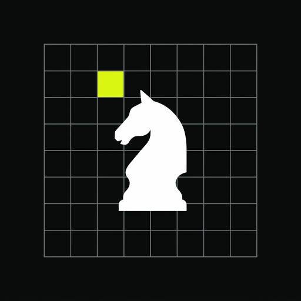
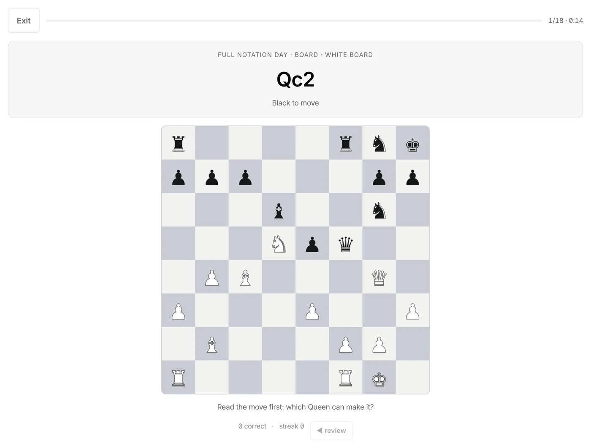

<p align="center">
  
</p>

<h1 align="center">Notation Coach</h1>

<p align="center"><strong>Read chess notation at a glance — one five-minute set a day.</strong></p>

<p align="center">
  <a href="https://chess-notation-coach.vercel.app/"></a>
  
  
</p>

<p align="center">
  <a href="https://chess-notation-coach.vercel.app/">Live app</a> ·
  <a href="https://chess-notation-coach.vercel.app/#/tricks">Cheat sheet</a> ·
  <a href="https://chess-notation-coach.vercel.app/skill.txt">skill.txt</a>
</p>

<p align="center">
  
</p>

## Problem

I can read algebraic notation. Slowly. `Nf3` still arrives as **N – f – 3**, three characters
translated one at a time, and by the time the destination is decoded the move is gone.

## Gap

That is not a knowledge gap — it is a **recognition** gap. Reading more games does not close it:

- **Reading is decoding.** Every square is resolved by counting files and ranks, so attention goes to
  the coordinates instead of the idea of the move.
- **Volume does not fix it.** A 40-puzzle binge once a week builds nothing. Five minutes at the edge of
  speed, every day, turns `Nf3` into a single chunk.
- **Practice tools forget you.** Puzzle sites optimise for puzzles, not habits: no schedule, no sense of
  what you are actually bad at, nothing waiting for you tomorrow.

## Solution

One daily set, chosen for you, timed, reviewable, streak-backed — and a one-line contract so your AI
runs the habit around it.

- **Plan** — the date seeds a seven-day theme rotation (grid → capture → knight → check → castle → full →
  speed); the coach appends extra reps to whatever your lifetime accuracy is worst at.
- **Drill** — 17–19 mixed reps, ~5 minutes, across seven drill kinds: empty-board coordinates, knight
  fans, SAN ↔ English both ways, real championship positions, mental geometry with no board.
- **Review** — `◀ review` (or ←) steps back through everything answered: the question, the right answer,
  what you picked, and the position with the move marked. Browsing never touches your score.
- **Bank** — answer 10 reps and the day counts. Wrong answers count too and come back at the end.

Nothing repeats: 5,784 items from 944 world championship games, keyed by content and skipped if a
previous day already served them (~5% repetition over 60 simulated days, none in the first four).
Both board sides are dealt per rep; Black-side boards flip files `h→a`, tint your half and caption the
side. No account, no server — progress is localStorage plus a base64 export code you can move between
browsers or hand to your assistant.

### A few examples

| Drill | What you see | What you do |
| --- | --- | --- |
| `grid` | "Click d5" on an empty board · "Rxd8 — is d8 light or dark?" | click the square, or say light/dark |
| `knight` | "Knight on f7 — click every square it can reach" (half the reps hide the knight) | click all eight destinations |
| `read` | "Bxf7+" · "Bishop takes f7, check" | pick the matching English / SAN |
| `play` | A real position, `Qc2`, black to move | read the move, then play it |
| `san` | The move highlighted on the board | pick its notation |
| `dest` | `Nbd2` | click the square it lands on |
| `mental` | "Knight on b5: how many of its moves land to the left?" | answer with no board |

## AI integration

The app is not an LLM wrapper — it is a deterministic trainer with a **contract** any assistant can
follow. Paste this one line into Muse, Grok, ChatGPT or Claude:

```
Read https://chess-notation-coach.vercel.app/skill.txt and follow the instructions.
```

That file asks the assistant for a reminder time, then sends one message a day with the dated deep link,
never invents a streak number, and never nags twice. It also carries the drill inventory, streak rules,
the message template, and how to decode an export code so a bot can state your *real* streak instead of
guessing. `skill.txt` is generated at build time from `public/llms.txt`, so the contract can't drift from
the code. An optional `src/data/coach-feed.json` lets an LLM pin a specific day's headline and theme.

## Run it

```bash
npm install
npm run dev       # http://localhost:5173
npm run build     # rebuilds drills from the PGN corpus, syncs skill.txt, bundles to dist/
```

Static deploy — `vercel deploy --prod`, or any static host. No server, no database, no key.

Deep links: `/#/today` · `/#/day/2026-11-16` (deterministic) · `/#/day/2026-11-16?theme=check` ·
`/#/streak` (heatmap, accuracy, export code) · `/#/tricks`.

## Credits

Built on **[Notation-Trainer](https://github.com/mattjliu/Notation-Trainer)** by
**Matthew Liu ([@mattjliu](https://github.com/mattjliu))**, MIT — the original app, and the source of the
946 PGN files (944 parsed) from world championship games 1886–2018 that every drill position comes from.
The copyright notice in [LICENSE](LICENSE) is his. Everything else — daily set builder, adaptive coach,
drill kinds, anti-repetition, streak/heatmap, in-session review, `skill.txt` — is this fork's work, under
the same licence. If you build on this, keep the upstream credit and the MIT notice; that is the whole
ask of the licence.

[MIT](LICENSE) · Copyright (c) 2020 Matthew Liu · modifications Copyright (c) 2026 Chris Dolinski
